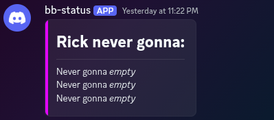
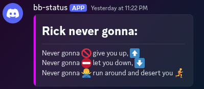
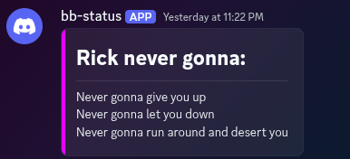

# Table of Contents
- [Table of Contents](#table-of-contents)
- [About](#about)
- [OS \& webhook support](#os--webhook-support)
- [Crate](#crate)
- [Usage](#usage)
  - [Config](#config)
  - [webhooks.d](#webhooksd)
  - [Sending new data via HTTP](#sending-new-data-via-http)
  - [Sending new data via client API](#sending-new-data-via-client-api)
- [Example](#example)
  - [Astley example](#astley-example)
  - [Client API example](#client-api-example)
- [Architecture](#architecture)
  
# About
**WeSAD (WEbhook Status and Alerting Daemon)**, is a small WORK IN PROGRESS program built in Rust as a centralized self-hosted service for managing webhook messages from various data sources.

I made it for my home server to solve a problem: I wanted a highly modifiable discord dashboard for my various, unrelated services running on my server. Of course, there are other solutions capable of doing this, but I wanted to do it myself :)

WeSAD solves this problem by acting as a single recipient for any and all status updates and alerts from my devices, scripts, and services. It stores all the data it receives, and then periodically refreshes appropriate webhooks with the current fresh data.

WeSAD allows for an indefinite number of concurrent webhooks, all with:
- Independent data
- Update intervals

And has (will have) two primary webhook "types" **Discord**:
- `status` messages,which are edited in-place such as for dashboards, and
- `alert` messages, which fire off new messages when requested.
  - Alerts are not yet implemented.

# OS & webhook support

WeSAD is currently designed for, and functions on, my particular Linux distribution (x86 CachyOS). Some small steps have been taken towards eventual cross-compatibility, but have not been tested. If this is something you'd like to see, please let me know!

**The service is designed primarily with Discord's webhooks in mind.** Currently,
some discord-sepcific URI flags are hard-coded into the HTTP requests, so this
is all it can be used for for the time being. 

I intend see what I can do to improve the webhook, and by extension general HTTP capabilities, of this service by moving some of the assumptions made by the code into the individual `webhook.conf` files. For example:
- URI flags
- Header values
- User-specified HTTP method per-webhook

Though as this is a little passion project, I make no promises.

# Crate
This project contains both:
1. The core daemonizable service, ran as a compiled binary.
2. A minimal client API, accessed as a library within the crate.

The client API was included to further minimize the code required for sending updates to the daemon from external scripts (see this [example](#client-api-example)).

The core service listens for updates via HTTP, so it is intended that you can still send status updates in situations where importing this crate is undesired or not feasible, *e.g.* some embedded devices, using other languages, etc...

# Usage
The usage pattern for WeSAD is to:
1. Configure your webhooks in the `webhooks.d` directory.
2. Run the service, ideally as a constant background process.
3. Use either HTTP POST or the client API to send updates to the service from other programs or devices.

Some examples of dashboard uses:
- Game server statuses 
  - Player counts, server load, TPS, ...
- Service statuses
  - VPN health, image server status, ...

## Config
The user provides configuration in the form of name-paired `.conf` and `.json` files in the project's `webhooks.d` directory, located in:
| OS      | Config Path                                                  |
|---------|--------------------------------------------------------------|
| Linux   | `~/alice/.config/wesad`                                        |
| Mac     | `/Users/Alice/Library/Application Support/com.beepdodev.wesad` |
| Windows | `C:\Users\Alice\AppData\Roaming\wesad\`                        |

If these locations do not appear, run the program once first with the `-i` or `--init` shout (Not yet implemented).

Lastly, if needed, there is a `wesad.conf` located in the above directory which
allows the user to specify a custom ip address and port. 
- It is highly recommended to keep the ip address as the default `0.0.0.0` unless you know what you're doing. 
- The port can be freely changed to your liking
  - Please note the default client api entrypoint `wesad::client::Client::new()` will use the default port of `22000`. If you wish to specify a custom port, you must build the client from the full endpoint url, e.g. `localhost:10101` using the `new_from_endpoint(url)` function instead. See [this example](#client-api-example).

## webhooks.d
Each pair of `.conf` and `.json` files must have the same name to be associated 
with one another, and both **must** be present for the program to read them e.g. `astley.conf` and `astley.json`.

Each `.conf` file contains header information about the webhook: 
```json
{
    "url" : "https://discord.com/api/webhooks/yourwebhook",
    "type" : "status",      // or "alert"
    "interval" : "seconds", // or "milliseconds", "mintues", "days"
    "period" : 7            // Based on the interval above. Integer values.
    "msg_id" : "abc123"     // For discord webhooks. Include if editing
                            //   an existing webhook message. Otherwise,
                            //   leave null or delete this line.
}
```
The `.json` file contains the full raw HTTP body for the webhook request. This should also include all placeholder values that will be replaced by live data, called `tags`. Tags are indicated using double dollar-signs around the key, for example `Never gonna $$give$$`.

- For an example HTTP body for **Discord**, check [astley.json](/example_dirs/etc/webhooks.d/astley.json)

## Sending new data via HTTP
By default, WeSAD will create a webserver on `localhost:22000`.
- You can check the service is active and listening by doing an HTTP `GET` to the endpoint `localhost:22000/health`
- Updated tag data for status webhooks is sent as a POST to the `/status` api endpoint. 
  - The only required header is `Content-type : application/json`. 
  - The body of the request should be structured as follows:
```json
{
    "webhook" : "astley",     // webhook identifier, same name as the .conf
    "update_type" : "status", // The webhook type
    "content" : [             // The tags to be updated. Formatted as an array
                              // of {tag, value} JSON obects, called TagValue
        {
            "tag" : "give",
            "value" : "give you up,"
        },
        {
            "tag" : "let",
            "value" : "let you down,"
        },
        {
            "tag" : "run",
            "value" : "run around and desert you."
        }
    ]
}
```

## Sending new data via client API
Alternatively, data can be sent to the service via the public client API in `wesad::client`. See the [examples](#client-api-example) section for an implementation of this approach.

# Example
## Astley example
In the [`example_dirs`](/example_dirs/) directory of this repo you can find example configs [`astley.conf`](/example_dirs/etc/webhooks.d/astley.conf) and [`astley.json`](/example_dirs/etc/webhooks.d/astley.json). If you make sure to replace the `url` in `astley.conf` with a valid discord webhook, you can test things out right away: 
- Compile (or download) the binary and run it once with the `-i` or `--init` command line argument.
  - This will run the service in "initialization" mode which will create the required folders on your computer then exit.
- Locate your OS's `wesad/etc/webhooks.d` config folder (see [here](#os--webhook-support) for that location) and move the `astley.conf` and `astley.json` files into it.
- Run the program again, this time with no additional command line arguments.
  - This will open attached to your terminal for easy log viewing and shutdown. 
  - At this time, you should also receive the blank webhook message in your server:



- Download the [`example-update.json`](/example_dirs/example-update.json) file from `example_dirs`. This is a fully formatted tag payload designed to work with this example.
- Open or otherwise navigate your terminal to the location of the `example-update.json` you just downloaded
- Run the (Linux) command `curl -i --header "Content-Type: application/json" --data "$(cat example-update.json)" "localhost:22000/status"` to send a POST with the `example-update.json` payload to the service.

In your WeSAD terminal, you should see an INFO log acknowledgement of the POST request.

The `astley.conf` example is set to update every `7` seconds, so wait, and soon enough you should see the *empty* tags replaced with the data from `example-update.json`!



At this point you can experiment with changing the `example-update.json` payload, tweaking the template `astley.json`, or start otherwise start setting up your own dashboard!

## Client API example
Using the same setup as the above Astley example, you can also send the updated data using the available API:
```rust
use wesad::client::{
    self,
    TagValue
};

let client = client::Client::new().unwrap();
// or, to specify the wesad endpoint, use
// let client = wesad::Client::new_from_url("https://192.168.0.123:12345");

let mut my_tag_data = Vec::new(); // Tags are sent in vector form...

// ... using the TagValue struct. 
// TagValue::new uses the arguments (tag, value), and accepts any params which 
//   implement the Display trait.
my_tag_data.push(TagValue::new("give", "give you up"));
my_tag_data.push(TagValue::new("let", "let you down"));
my_tag_data.push(TagValue::new("run", "run around and desert you"));

// Here, the webhook name receiving the tags is "astley" (`.conf`)
client.send_tags("astley", my_tag_data);
```




# Architecture
The program uses an [sqlite](https://docs.rs/sqlite/latest/sqlite/) database to store all persistent webhook and tag data. On startup, it will build paths to the OS's project directories using the [directories](https://docs.rs/directories/latest/directories/index.html) crate. 

A long-running `listener` thread uses [tokio](https://docs.rs/tokio/latest/tokio/) to build an asynchronous TCP webserver and listen for updates which get pushed into the [sqlite](https://docs.rs/sqlite/latest/sqlite/) database. Simultaneously, the long-lived `updater` thread also uses [tokio](https://docs.rs/tokio/latest/tokio/) for sending HTTP requests to the webhook target endpoints based on the current values in the database.

Each webhook configuration file contains its own information about update type, and interval. Within the `updater` thread, the program dynamically sleeps after every update cycle until the next udpate is due, so as to reduce impact on compute resources. The exact timing of the `updater` is likely quite unreliable, and your prescribed interval should be considered more an estimate than an exact value.